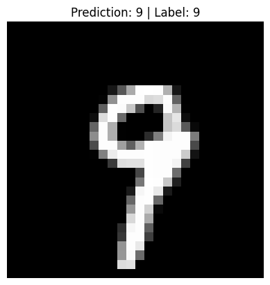
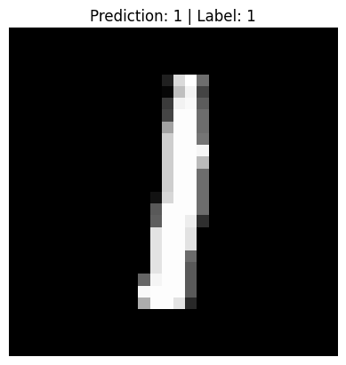
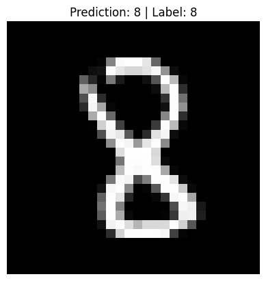
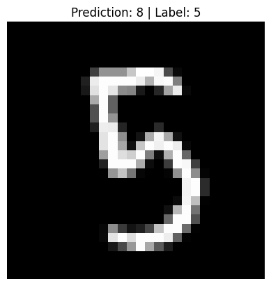
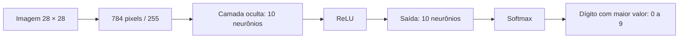

<div align="center">

# Dígitos, pixels e uma rede neural

**Reconhecimento de dígitos manuscritos com uma rede neural construída em NumPy.**


784 pixels de entrada · 10 neurônios ocultos · 10 classes

[Executar](#como-executar) · [Previsões](#previsões-na-prática) · [Arquitetura](#como-a-rede-funciona) · [Dados](#dados-e-treinamento)

</div>

## Sobre o projeto

Uma implementação didática para acompanhar o que acontece dentro de uma rede neural: inicialização dos pesos, propagação direta, cálculo dos gradientes e atualização dos parâmetros. As operações da rede são implementadas com NumPy, sem TensorFlow ou PyTorch.

Cada imagem de **28 × 28 pixels** é transformada em um vetor de 784 valores. A rede aprende a associar esses valores a um dos dígitos de **0 a 9**.

## Previsões na prática

Exemplos reais de uma execução local. `Prediction` é o dígito previsto pela rede; `Label` é o rótulo do conjunto de dados.

<table>
  <tr>
    <td align="center" width="50%">
      
      <br><strong>Acerto · 9 → 9</strong>
    </td>
    <td align="center" width="50%">
      
      <br><strong>Acerto · 1 → 1</strong>
    </td>
  </tr>
  <tr>
    <td align="center">
      
      <br><strong>Acerto · 8 → 8</strong>
    </td>
    <td align="center">
      
      <br><strong>Erro · 5 → 8</strong>
    </td>
  </tr>
</table>

As setas indicam **rótulo real → previsão**. A galeria inclui um erro para mostrar o comportamento observado. Esses quatro exemplos pertencem ao conjunto de treinamento e não medem o desempenho em imagens novas. As imagens em `docs/images/` foram exportadas em uma execução local e são cópias fixas para documentação. O script original exibe as previsões com Matplotlib, sem salvar os PNGs automaticamente.

## Como executar

Pré-requisitos: **Python 3**, Git e suporte a ambientes virtuais (`venv`). O fluxo foi conferido em um ambiente com Python 3.10. O arquivo `train.csv` já está incluído no repositório.

### 1. Baixe o projeto

```bash
git clone https://github.com/renandevcode/training_neuralnetwork.git
cd training_neuralnetwork
```

### 2. Crie e ative um ambiente virtual

Linux / macOS:

```bash
python3 -m venv .venv
source .venv/bin/activate
```

Windows, no PowerShell:

```powershell
py -m venv .venv
.venv\Scripts\Activate.ps1
```

### 3. Instale as dependências e execute

```bash
python -m pip install numpy pandas matplotlib
python training.py
```

Execute a partir da pasta do projeto: o script lê `train.csv` pelo diretório atual.

### O que aparece ao executar

- O treinamento realiza **500 iterações** e imprime a acurácia de treinamento a cada **10 iterações**. Um valor como `0.85` significa 85% de acertos naquele conjunto e naquela iteração.
- Ao terminar, imprime `Prediction` e `Label` para quatro imagens e chama `plt.show()` para exibi-las.
- Em um ambiente com backend gráfico interativo, abre as imagens em janelas. Feche cada janela para continuar.
- Em servidores e ambientes sem interface gráfica, o backend `Agg` permite executar o treinamento, mas não exibe janelas nem salva imagens automaticamente. Para executar explicitamente nesse modo no Linux/macOS:

```bash
MPLBACKEND=Agg python training.py
```

Nesse modo, `plt.show()` pode emitir o aviso `FigureCanvasAgg is non-interactive`. O aviso afeta a exibição das imagens; os exemplos exportados continuam disponíveis em `docs/images/`.

O tempo de execução depende da máquina. Os dados são embaralhados e os pesos inicializados aleatoriamente, portanto imagens, previsões e acurácia podem mudar a cada execução.

## Como a rede funciona



| Etapa | O que acontece no código |
| :--- | :--- |
| Preparação | Separa rótulos e pixels, embaralha as amostras e normaliza os pixels dividindo por 255. |
| Propagação direta | Calcula as ativações com os pesos e vieses atuais, usando ReLU e softmax. |
| Retropropagação | Usa os rótulos em formato one-hot para calcular os gradientes. |
| Atualização | Ajusta pesos e vieses por descida do gradiente, com taxa de aprendizado de 0,10. |
| Previsão | Escolhe o índice de maior ativação na saída com `argmax`. |

## Dados e treinamento

| Item | Configuração atual |
| :--- | :--- |
| Arquivo | `train.csv`, incluído no repositório |
| Amostras | 42.000 imagens |
| Colunas | `label` + 784 colunas de pixels (`pixel0` a `pixel783`) |
| Intensidade dos pixels | De 0 a 255; normalizada para o intervalo de 0 a 1 |
| Classes | Dígitos de 0 a 9 |
| Separação | 1.000 amostras para desenvolvimento e 41.000 para treinamento |
| Arquitetura | 784 → 10 → 10 |
| Taxa de aprendizado | 0,10 |
| Iterações | 500 |

O script prepara `X_dev` e `Y_dev`, mas não calcula a acurácia desse conjunto. A acurácia impressa e as quatro imagens finais usam dados de treinamento. Os pesos ficam em memória e não são salvos: cada execução inicia um novo treinamento.

## Organização

```text
training_neuralnetwork/
├── README.md
├── training.py              # Preparação, treinamento e previsões
├── train.csv                # Imagens rotuladas em formato tabular
└── docs/
    └── images/              # Exemplos fixos exibidos neste README
```

## Problemas comuns

| Mensagem ou situação | Como resolver |
| :--- | :--- |
| `ModuleNotFoundError` | Ative a `.venv` e instale as três dependências com o comando acima. |
| `FileNotFoundError: train.csv` | Execute `python training.py` dentro da pasta que contém o CSV. |
| Nenhuma janela aparece | Confira se o ambiente tem interface gráfica e um backend interativo do Matplotlib. Os exemplos do README estão em `docs/images/`. |
| `FigureCanvasAgg is non-interactive` | O backend `Agg` não abre janelas. O treinamento pode terminar normalmente; para visualizar as previsões da execução, use um ambiente com backend gráfico interativo. |
| `No module named venv` ou erro de `ensurepip` no Ubuntu/Debian | Instale o pacote `python3-venv` com o gerenciador de pacotes do sistema e recrie o ambiente. |

---

Projeto de estudo para explorar redes neurais a partir das operações matemáticas.
